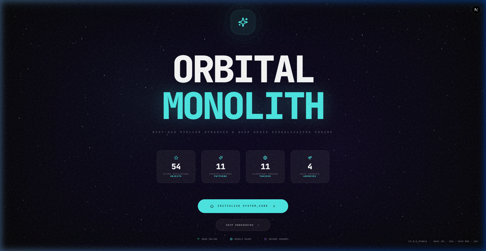
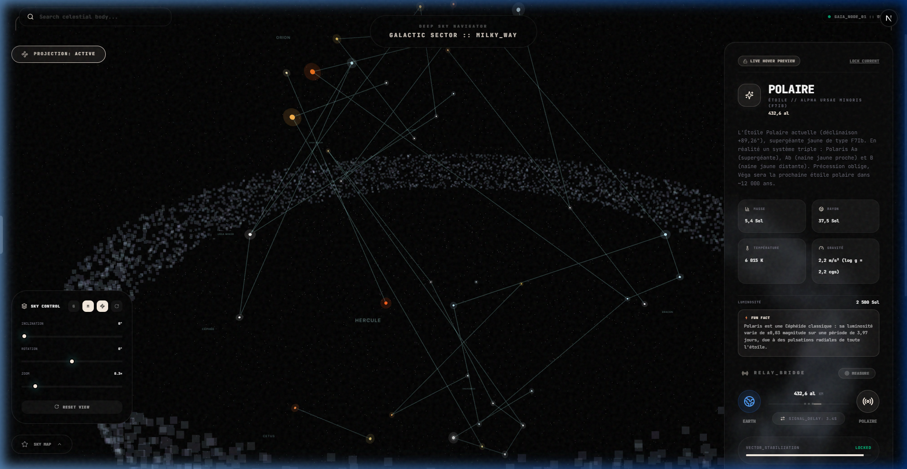
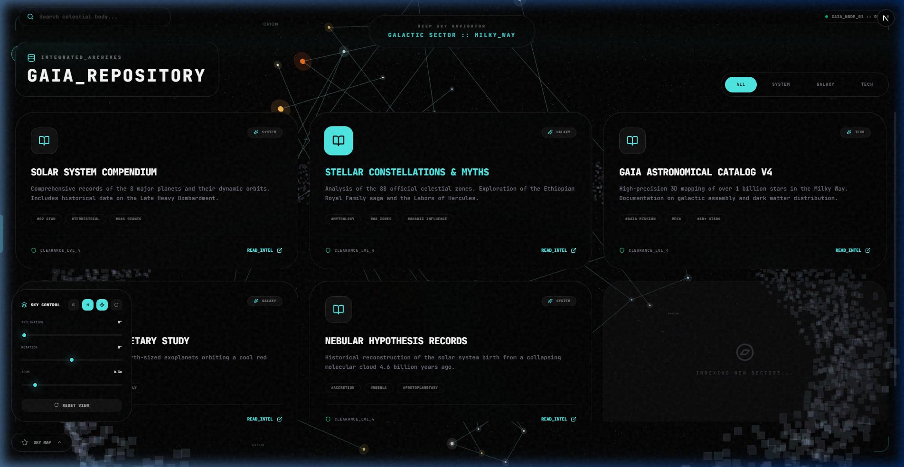
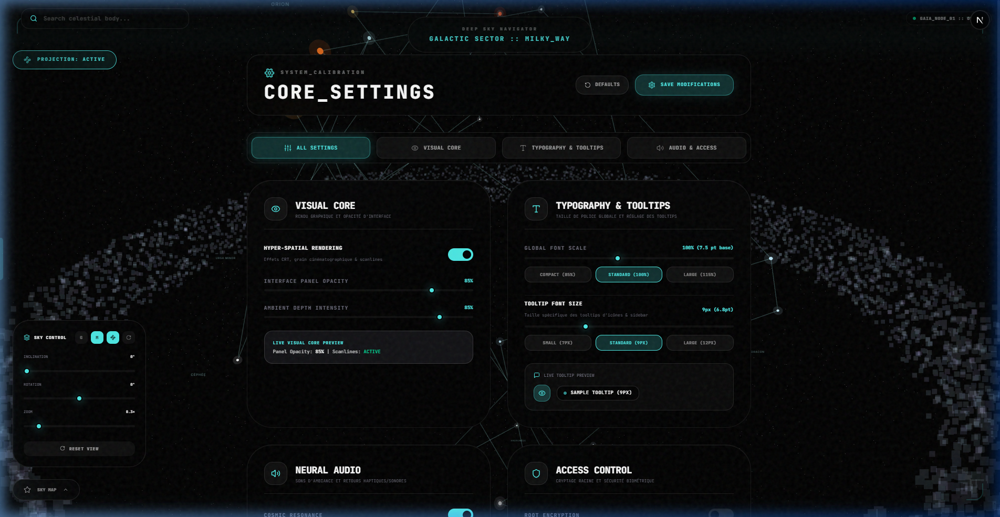

<div align="center">
# 🌌 Orbital Monolith v3.6

**A cutting-edge 3D WebGL space exploration and celestial telemetry dashboard.**

[](https://nextjs.org/)
[](https://threejs.org/)
[](https://tailwindcss.com/)
[](https://www.typescriptlang.org/)

</div>

---

## 📖 About

**Orbital Monolith** is an interactive, high-performance 3D astrophysics exploration dashboard. Built with Next.js 16 and Three.js, it offers real-time space visualization and authentic astrophysical telemetry (mass, gravity, surface temperature, spectral class, and orbital delay). Users can navigate the Solar System, explore the Sky Map catalog, lock onto target celestial bodies, measure interplanetary distances with a 3D laser rangefinder, and calibrate system rendering parameters in real time.

---

## 📸 Interface Overview

<div align="center">
  
  
  <br/>
  
  
</div>

---

## ✨ Key Features

- **🪐 Persistent 3D WebGL Engine (`UniverseEngineContext`)**: High-performance Three.js rendering of planets, stars, and atmospheric glows. The canvas remains mounted across routes for zero-latency, seamless transitions with built-in WebGL context recovery (`webglcontextlost`).
- **🛰️ Authentic Telemetry Stream (`useTelemetry`)**: Real-time astrophysically accurate data feed detailing orbital velocities, spectral classes, surface gravities, escape velocities, and atmospheric profiles.
- **🎯 Target Locking & Live Hover Inspection**: Instant live hover previews on stars and planets. Lock targets for deep telemetry analysis or trigger the full-screen `FocusView` inspection mode.
- **📏 Astrometrical 3D Laser Rangefinder (`AstrometricalBridge`)**: Interactive 3D measurement tool calculating real-time distances between Earth and target bodies, or between any 2 custom selected celestial nodes with dynamic 3D laser line rendering.
- **🎛️ Collapsible Scene Control Deck (`SceneControlPanel`)**: Dynamic scene customization including rotation angle (-180° to 180°), inclination (0° to 90°), orbital zoom, grid overlays, and Milky Way background toggles. Features a smooth collapse/expand toggle for zero-clutter 3D views.
- **🙈 Retractable Edge-Hover Sidebar**: Auto-hiding navigation sidebar that slides out when cursor leaves the left edge, granting 100% viewport width to the WebGL canvas.
- **🔤 Dynamic Typography & Tooltip Scaling**: Independent global font size scaling (80% to 125%) and specific icon tooltip size control (7px to 14px) with live preview widgets and instant DOM variable synchronization.
- **🎨 Visual Core Rendering Engine**: Custom glassmorphism opacity control (`--basalt-opacity`), ambient depth intensity (`--ambient-occlusion`), and optional hyper-spatial CRT scanlines (`data-hyperspatial`).
- **💻 Real-Time System Diagnostics (`Advanced Diagnostics Engine`)**: Live hardware telemetry monitoring actual FPS (calculated via `requestAnimationFrame`), JS Heap memory footprint (`performance.memory`), WebGL GPU renderer hardware string, active catalog node count (264 objects), and `localStorage` byte usage.
- **🔔 Floating Alert Popover**: Independent notification overlay detached from the sidebar for unhindered alert inspection.

---

## 🏗️ Architecture & Project Structure

> 📐 Full technical architecture (WebGL engine lifecycle, state model, data flows, ADRs, technical debt): see [docs/SYSTEM_DESIGN.md](docs/SYSTEM_DESIGN.md).

```text
Orbital-Monolith/
├── src/
│   ├── app/
│   │   ├── dashboard/
│   │   │   ├── archive/        # Gaia Catalog & Knowledge Base
│   │   │   ├── map/            # Star Cartography View
│   │   │   ├── settings/       # System Calibration & Hardware Diagnostics
│   │   │   ├── layout.tsx      # Dashboard Shell (WebGL canvas & Navigation)
│   │   │   └── page.tsx        # Sector Control View
│   │   ├── globals.css         # Tailwind v4 styles & Basalt design tokens
│   │   └── layout.tsx          # Root Next.js Layout
│   ├── components/
│   │   ├── ui/                 # Reusable UI overlays & controls
│   │   └── view/               # Three.js 3D scene logics (SolarSystemView, SkyMapView)
│   ├── constants/              # JPL & Gaia DR3 Astrophysical Datasets
│   ├── hooks/                  # Custom Hooks (useTelemetry, useAccentColors, etc.)
│   ├── lib/                    # React Contexts (DashboardContext, UniverseEngineContext)
│   ├── services/               # Celestial distance calculations & search
│   └── types/                  # TypeScript Data Models
├── CHANGELOG.md                # Detailed Version History
└── README.md                   # Project Documentation
```

---

## 🛠️ Tech Stack

- **Framework**: [Next.js 16 (App Router)](https://nextjs.org/)
- **3D Engine**: [Three.js](https://threejs.org/) & `three-stdlib`
- **UI & Styling**: [Tailwind CSS v4](https://tailwindcss.com/) & [Framer Motion](https://www.framer.com/motion/)
- **State & Context**: React Context API (`DashboardContext`, `UniverseEngineContext`)
- **Icons**: [Lucide React](https://lucide.dev/)
- **Language**: [TypeScript 5](https://www.typescriptlang.org/)

---

## 🚀 Getting Started

### Prerequisites

- Node.js v18+ 
- npm, yarn, or pnpm

### Installation

1. **Clone the repository & install dependencies**:
   ```bash
   npm install
   ```

2. **Configure Environment Variables**:
   Create a `.env.local` file in the root directory if integrating external APIs:
   ```env
   GEMINI_API_KEY=your_gemini_api_key_here
   ```

3. **Start the Development Server**:
   ```bash
   npm run dev
   ```

4. **Launch Application**:
   Open [http://localhost:3000](http://localhost:3000) in your browser.

---

## 📜 Available Scripts

- `npm run dev` - Launches the Next.js development server with Turbopack.
- `npm run build` - Compiles the production application bundle.
- `npm run start` - Runs the compiled production build.
- `npm run lint` - Runs ESLint code quality checks.
- `npx tsc --noEmit` - Executes TypeScript strict type checking.

---

## 📋 Changelog

All updates, bug fixes, and feature additions are tracked in the [CHANGELOG.md](CHANGELOG.md) file.
