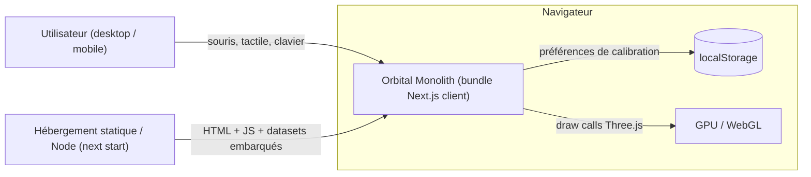
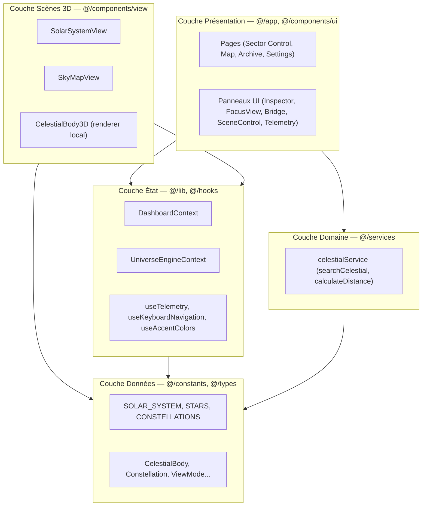
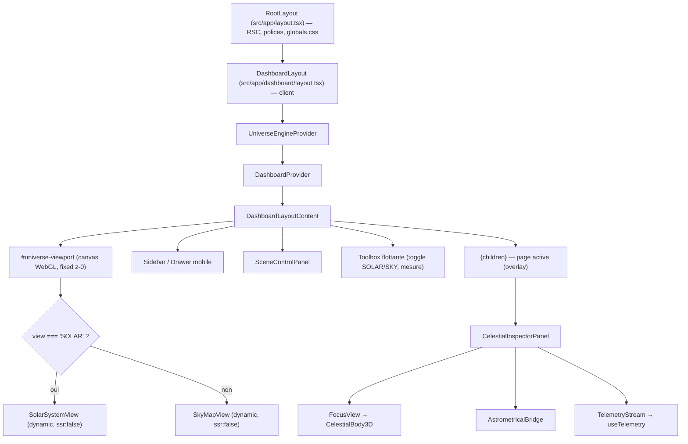
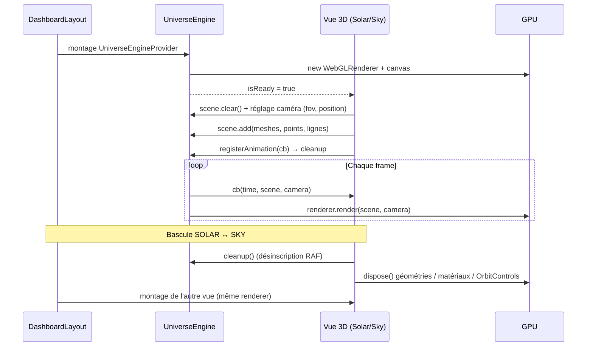
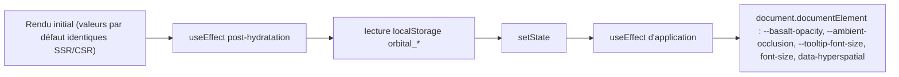
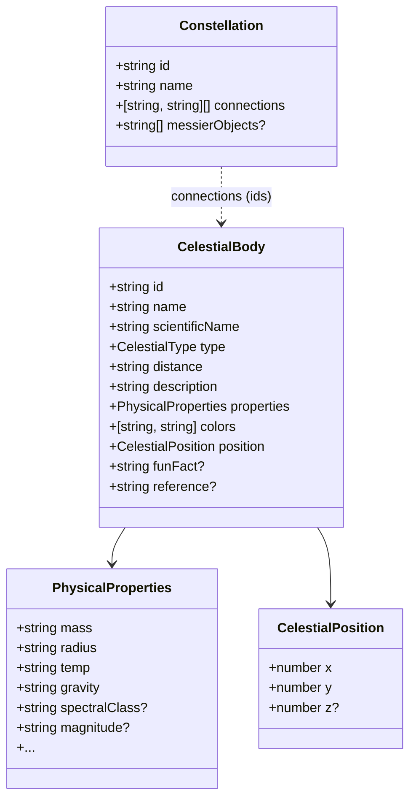
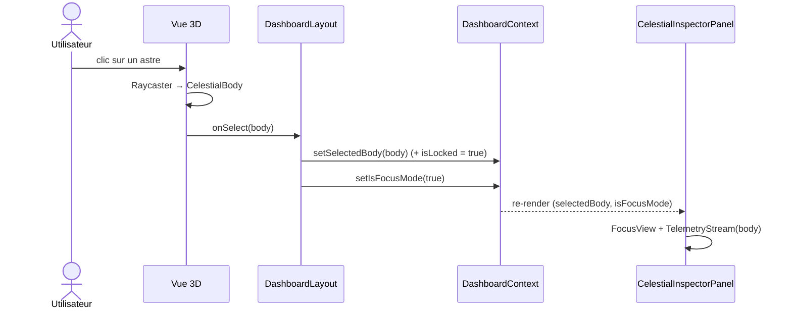
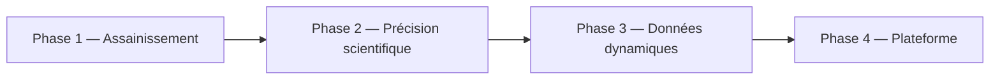

# 🛰️ Orbital Monolith — System Design

> **Version du document** : 1.0 — basé sur la codebase v3.6
> **Portée** : architecture technique front-end, moteur WebGL, état applicatif, flux de données, performance.
> **Documents liés** : [README.md](../README.md) · [AGENTS.md](../AGENTS.md) · [CHANGELOG.md](../CHANGELOG.md)

---

## Sommaire

1. [Vue d'ensemble](#1-vue-densemble)
2. [Objectifs & non-objectifs](#2-objectifs--non-objectifs)
3. [Contexte système (C4 — niveau 1)](#3-contexte-système-c4--niveau-1)
4. [Stack technique](#4-stack-technique)
5. [Architecture en couches](#5-architecture-en-couches)
6. [Topologie des routes](#6-topologie-des-routes)
7. [Arbre des providers & composition du layout](#7-arbre-des-providers--composition-du-layout)
8. [Moteur WebGL persistant](#8-moteur-webgl-persistant)
9. [Modèle d'état](#9-modèle-détat)
10. [Couche de données](#10-couche-de-données)
11. [Flux de données clés](#11-flux-de-données-clés)
12. [Couches visuelles (z-index) & interaction](#12-couches-visuelles-z-index--interaction)
13. [Responsive & ergonomie tactile](#13-responsive--ergonomie-tactile)
14. [Performance & gestion des ressources GPU](#14-performance--gestion-des-ressources-gpu)
15. [Résilience & gestion d'erreurs](#15-résilience--gestion-derreurs)
16. [Décisions d'architecture (ADR)](#16-décisions-darchitecture-adr)
17. [Dette technique identifiée](#17-dette-technique-identifiée)
18. [Évolutions envisagées](#18-évolutions-envisagées)

---

## 1. Vue d'ensemble

**Orbital Monolith** est un tableau de bord d'exploration astrophysique en 3D, exécuté **entièrement côté client** au-dessus de Next.js (App Router). Il propose deux scènes 3D (Système Solaire et Carte Stellaire) rendues par **un unique renderer WebGL persistant**, sur lequel se superposent des panneaux d'interface (inspecteur, télémétrie, télémètre laser, calibration).

Caractéristiques structurantes :

| Propriété | Choix |
|---|---|
| Type d'application | SPA « shell persistant » dans Next.js App Router |
| Backend | Aucun (pas d'API, pas de base de données) |
| Source de données | Datasets statiques embarqués (`@/constants`) |
| Rendu 3D | Three.js r170, 1 renderer partagé + 1 renderer local (FocusView) |
| Persistance | `localStorage` (préférences de calibration uniquement) |
| État global | 2 React Contexts (`DashboardContext`, `UniverseEngineContext`) |

---

## 2. Objectifs & non-objectifs

### Objectifs

- **Transitions sans latence** entre routes : le canvas WebGL n'est jamais démonté lors de la navigation dans `/dashboard/*`.
- **Fidélité scientifique** : données JPL (Système Solaire) et Gaia DR3 (étoiles) typées strictement.
- **Fluidité 60 FPS** sur matériel grand public, avec un plafond de `devicePixelRatio` à 2.
- **Mobile-first** : drawer de navigation, bottom sheet, cibles tactiles ≥ 44 px, `touch-action: none` sur le viewport 3D.
- **Personnalisation live** de l'interface (opacité, typographie, effets) via variables CSS.

### Non-objectifs (actuels)

- Authentification, comptes utilisateurs, synchronisation multi-appareils.
- Données astronomiques temps réel issues d'API externes (la télémétrie est **simulée** à partir des propriétés réelles).
- Rendu côté serveur des scènes 3D (impossible et inutile : dépend de `window`/WebGL).

---

## 3. Contexte système (C4 — niveau 1)



Il n'existe **aucune dépendance réseau à l'exécution** une fois le bundle chargé : toutes les données astronomiques sont compilées dans le JavaScript.

---

## 4. Stack technique

| Domaine | Technologie | Rôle |
|---|---|---|
| Framework | Next.js 16 (App Router), React 19 | Routage, layouts persistants, code splitting |
| Langage | TypeScript 5.8 (strict) | Typage des modèles astrophysiques |
| 3D | `three` 0.170, `three-stdlib` (`OrbitControls`) | Scènes, caméras, raycasting |
| UI | Tailwind CSS v4, `framer-motion`, `lucide-react` | Styles, animations, icônes SVG |
| Utilitaires | `clsx`, `tailwind-merge` | Composition de classes |
| Polices | `next/font` — Inter (`--font-sans`), JetBrains Mono (`--font-mono`) | Typographie |
| Qualité | ESLint 9, `tsc --noEmit` (`npm run type-check`) | Validation statique |

---

## 5. Architecture en couches



**Règles de dépendance** :

- Les couches supérieures dépendent des couches inférieures, jamais l'inverse.
- `@/types` est la feuille de l'arbre : aucun import applicatif.
- Les scènes 3D ne créent **pas** de canvas (sauf `CelestialBody3D`, cf. [ADR-004](#adr-004--renderer-local-pour-focusview)) ; elles peuplent la scène partagée.
- Toute logique de calcul pur (recherche, distance) vit dans `@/services`, sans dépendance React.

---

## 6. Topologie des routes

| Route | Fichier | Type | Rôle |
|---|---|---|---|
| `/` | [page.tsx](../src/app/page.tsx) | Client | Landing page |
| `/onboarding` | [page.tsx](../src/app/onboarding/page.tsx) | Client | Séquence d'introduction → `/dashboard` |
| `/dashboard` | [page.tsx](../src/app/dashboard/page.tsx) | Client (overlay) | Sector Control — `CelestialInspectorPanel` |
| `/dashboard/map` | [page.tsx](../src/app/dashboard/map/page.tsx) | Client (overlay) | Star Cartography — force `view = 'SKY'` |
| `/dashboard/archive` | [page.tsx](../src/app/dashboard/archive/page.tsx) | Client (opaque) | Catalogue Gaia & base de connaissances |
| `/dashboard/settings` | [page.tsx](../src/app/dashboard/settings/page.tsx) | Client (opaque) | Calibration système & diagnostics matériels |

Deux catégories de pages coexistent sous `/dashboard` :

- **Overlay** : le canvas 3D reste interactif (`pointer-events: auto`), la page ne fait qu'ajouter des panneaux.
- **Opaque** (`archive`, `settings`) : le viewport 3D passe en `pointer-events: none` ; la scène continue d'être rendue en arrière-plan.

---

## 7. Arbre des providers & composition du layout



Points clés :

- Le `DashboardLayout` est **monté une seule fois** pour toutes les routes `/dashboard/*` : c'est ce qui garantit la persistance du renderer.
- Les vues 3D sont chargées via `next/dynamic` avec `ssr: false` (obligatoire : Three.js accède à `window`).
- Une seule scène est montée à la fois ; le basculement `SOLAR ↔ SKY` démonte l'une (cleanup GPU) et monte l'autre **sur le même renderer**.

---

## 8. Moteur WebGL persistant

Implémenté dans [UniverseEngineContext.tsx](../src/lib/UniverseEngineContext.tsx).

### 8.1 Responsabilités

| Responsabilité | Détail |
|---|---|
| Création unique | `PerspectiveCamera(60°, near 0.1, far 50000)` + `WebGLRenderer({ antialias, alpha, powerPreference: 'high-performance' })` |
| Qualité | `ACESFilmicToneMapping`, `pixelRatio = min(dpr, 2)` |
| Boucle RAF | Une seule boucle `requestAnimationFrame` exécute tous les callbacks enregistrés puis `renderer.render()` |
| Redimensionnement | `ResizeObserver` sur le conteneur → mise à jour `aspect` + `setSize` |
| Résilience | Écoute `webglcontextlost` (`preventDefault`) / `webglcontextrestored` |
| Disposal | Au démontage : arrêt RAF, `traverse()` + `dispose()` géométries/matériaux, `renderer.dispose()` |

### 8.2 API exposée

```ts
interface UniverseEngineContextValue {
  scene: THREE.Scene;                                   // scène partagée
  camera: RefObject<THREE.PerspectiveCamera | null>;    // caméra globale
  renderer: RefObject<THREE.WebGLRenderer | null>;
  containerRef: RefObject<HTMLDivElement | null>;       // où le canvas est monté
  registerAnimation: (cb: AnimationCallback) => () => void; // retourne le cleanup
  isReady: boolean;                                     // true après montage du canvas
}
```

### 8.3 Cycle de vie d'une scène (contrat pour toute nouvelle vue)



**Contrat obligatoire pour une vue 3D** :

1. Attendre `isReady` dans un `useEffect` (jamais `useMemo` pour construire des objets GPU).
2. Collecter les ressources créées (`disposables`, `disposableMats`) et les libérer au cleanup.
3. Enregistrer l'animation via `registerAnimation` et appeler la fonction retournée au cleanup.
4. Ne jamais créer de `WebGLRenderer` ni de `<canvas>`.
5. Remonter les interactions via les props `onSelect(body)` / `onHover(body | null)`.

### 8.4 Interaction (picking)

Chaque vue instancie un `THREE.Raycaster` et convertit les coordonnées pointeur en NDC pour détecter survol et clic sur les corps célestes. `OrbitControls` (three-stdlib) gère rotation/zoom ; l'orientation et le zoom sont synchronisés avec `DashboardContext` (`orientation`, `zoom`).

---

## 9. Modèle d'état

### 9.1 `DashboardContext` — état métier & UI

Source : [DashboardContext.tsx](../src/lib/DashboardContext.tsx).

| Domaine | État | Défaut | Persisté |
|---|---|---|---|
| Vue | `view: 'SOLAR' \| 'SKY'` | `'SKY'` | Non |
| Sélection | `selectedBody`, `hoveredBody`, `isLocked` | Polaris, `null`, `false` | Non |
| Recherche | `searchQuery` | `''` | Non |
| Focus | `isFocusMode` | `false` | Non |
| Caméra | `orientation {rotation, inclination}`, `zoom`, `perspectiveMode` | `0/0`, `0.3`, `'heliocentric'` | Non |
| Layers | `showGrid`, `showMilkyWay`, `showConstellations` | `false`, `true`, `true` | Non |
| Mesure | `isMeasuringMode`, `distancePoints` (fenêtre glissante de 2) | `false`, `[]` | Non |
| Calibration | `interfaceOpacity`, `ambientOcclusion`, `hyperSpatialRendering`, `fontSizeScale`, `tooltipFontSize` | 85, 85, `true`, 100, 9 | **Oui** |
| Calibration (session) | `cosmicResonance`, `interfaceVolume`, `rootEncryption`, `biometricLink` | — | Non |

### 9.2 Persistance & hydratation



Clés `localStorage` : `orbital_interface_opacity`, `orbital_ambient_occlusion`, `orbital_hyperspatial`, `orbital_font_scale`, `orbital_tooltip_font_size`.

Ce schéma « défauts puis lecture différée » évite tout **hydration mismatch**. Les setters écrivent simultanément dans le state, `localStorage` et les variables CSS du DOM (mise à jour instantanée sans re-render global des styles).

### 9.3 État local (hors contexte)

- **Layout** : `isSidebarHovered`, `isMobileDrawerOpen`, `toolboxOpen`, `showNotifications`.
- **Vues 3D** : références Three.js (`planetsRef`, `sunRef`, `controlsRef`, `laserRef`…) stockées dans des `useRef` pour ne jamais déclencher de re-render React à 60 FPS.
- **Télémétrie** : `useTelemetry` maintient un buffer circulaire (`limit` = 20) alimenté toutes les 2,5 s.

---

## 10. Couche de données

### 10.1 Datasets

Source : [constants/index.ts](../src/constants/index.ts).

| Export | Type | Origine |
|---|---|---|
| `SOLAR_SYSTEM` | `CelestialBody[]` | NASA JPL (planètes, planètes naines, Soleil) |
| `STARS` | `CelestialBody[]` | Gaia DR3 / catalogues stellaires |
| `CONSTELLATIONS` | `Constellation[]` | Connexions `[starIdA, starIdB][]` référençant `STARS` |

### 10.2 Modèle



Les propriétés physiques sont stockées en **chaînes formatées** (ex. `"5,778 K"`) : idéal pour l'affichage, mais nécessite un parsing (regex) dès qu'un calcul est requis (ex. `visualRadius()` dans `SolarSystemView`).

### 10.3 Services

[celestialService.ts](../src/services/celestialService.ts) :

- `searchCelestial(query)` — filtre linéaire `O(n)` sur `name` et `scientificName` de `SOLAR_SYSTEM ∪ STARS`.
- `calculateDistance(a, b)` — distance euclidienne 2D sur `position` (approximation de démonstration).

---

## 11. Flux de données clés

### 11.1 Sélection d'un corps céleste



Chemins alternatifs vers la même action : **recherche** (sidebar → `searchCelestial` → `handleSelectBody`, redirection vers `/dashboard` si page opaque) et **clavier** (`←` / `→` dans `useKeyboardNavigation`).

### 11.2 Mesure de distance (télémètre laser)

1. `toggleMeasuringMode()` active le mode (et purge les points à la désactivation).
2. Chaque clic appelle `addDistancePoint(body)` : déduplication, fenêtre glissante de 2 points.
3. La vue 3D trace une `THREE.Line` (`laserRef`) entre les deux positions.
4. `AstrometricalBridge` affiche le résultat via `calculateDistance()`.

### 11.3 Raccourcis clavier

| Touche | Action |
|---|---|
| `←` / `→` | Corps précédent / suivant dans la liste de la vue active |
| `Échap` | Quitter le mode focus |
| `V` | Basculer `SOLAR` ↔ `SKY` |
| `G` | Grille |
| `M` | Voie Lactée |
| `P` | Perspective `heliocentric` ↔ `free` |

Les raccourcis sont ignorés lorsque le focus est dans un `input`, `textarea` ou élément `contenteditable`.

---

## 12. Couches visuelles (z-index) & interaction

| z-index | Couche | `pointer-events` |
|---|---|---|
| `0` | `#universe-viewport` (canvas WebGL) | `auto` (overlay) / `none` (pages opaques) |
| `10` | Contenu de page (panneaux) | sélectif |
| `50` | Sidebar | `auto` |
| `60` | Toolbox flottante | `auto` |
| `110` | Bouton menu mobile | `auto` |
| `199` | Scanline CRT | `none` |
| `200` | Grain cinématique | `none` |

Les conteneurs d'overlay utilisent `pointer-events: none` et réactivent `auto` uniquement sur les éléments interactifs, afin que le canvas reçoive les gestes partout ailleurs.

---

## 13. Responsive & ergonomie tactile

| Breakpoint | Navigation | Inspecteur |
|---|---|---|
| `≥ 768px` | Sidebar rétractable (révélée au survol du bord gauche) | Panneau latéral |
| `< 768px` | Navigation Drawer coulissant + backdrop flouté | Bottom Sheet |

- Cibles interactives : `min-h-[44px]`.
- `touch-action: none` sur `#universe-viewport` pour empêcher le scroll navigateur pendant les gestes 3D.
- Le drawer se ferme automatiquement à chaque changement de `pathname`.

---

## 14. Performance & gestion des ressources GPU

| Levier | Mise en œuvre |
|---|---|
| Renderer unique | Pas de recréation de contexte WebGL lors de la navigation |
| Code splitting | Vues 3D en `dynamic(..., { ssr: false })` |
| Boucle unique | Un seul `requestAnimationFrame` pour toutes les animations |
| Pas de re-render à 60 FPS | Objets Three.js dans des `useRef`, mutations impératives |
| Géométries groupées | Starfields en `BufferGeometry` + `Points` (8 000 étoiles = 1 draw call) |
| Pixel ratio plafonné | `min(devicePixelRatio, 2)` |
| Disposal systématique | Géométries, matériaux, contrôles libérés au démontage de chaque vue |
| Recherche mémoïsée | `useMemo` sur `searchQuery` |

**Diagnostics intégrés** (page Settings) : FPS mesurés via RAF, heap JS (`performance.memory`), chaîne GPU WebGL, nombre de nœuds du catalogue, octets `localStorage`.

**Budget cible** : 60 FPS desktop, ≥ 30 FPS mobile milieu de gamme, 1 seul contexte WebGL actif hors FocusView.

---

## 15. Résilience & gestion d'erreurs

| Risque | Mitigation actuelle |
|---|---|
| Perte du contexte WebGL | `webglcontextlost` intercepté (`preventDefault`), `setSize` à la restauration |
| Hook utilisé hors provider | `useUniverseEngine()` / `useDashboard()` lèvent une erreur explicite |
| Hydration mismatch | Défauts identiques SSR/CSR, lecture `localStorage` post-montage |
| Conteneur de taille nulle | `ResizeObserver` ignore `w === 0 \|\| h === 0` ; aspect protégé par `Math.max(h, 1)` |
| Fuite mémoire GPU | Disposal exhaustif par vue + au démontage du provider |

---

## 16. Décisions d'architecture (ADR)

### ADR-001 — Renderer WebGL unique dans le layout

- **Contexte** : recréer un renderer par page provoquait latence, flashs noirs et risque de dépasser la limite de contextes WebGL du navigateur.
- **Décision** : un `UniverseEngineProvider` dans `dashboard/layout.tsx`, les vues ne font que peupler la scène.
- **Conséquences** : transitions instantanées ; impose un contrat strict de cleanup par vue.

### ADR-002 — React Context plutôt qu'une librairie d'état

- **Contexte** : état modeste, mono-utilisateur, sans données serveur.
- **Décision** : `DashboardContext` + `UniverseEngineContext`.
- **Conséquences** : zéro dépendance ; en contrepartie, tout consommateur de `useDashboard()` re-render à chaque changement (cf. [dette](#17-dette-technique-identifiée)).

### ADR-003 — Datasets statiques embarqués

- **Contexte** : données astronomiques quasi immuables.
- **Décision** : constantes TypeScript typées dans `@/constants`.
- **Conséquences** : fonctionnement hors-ligne, aucune latence ; augmente la taille du bundle initial.

### ADR-004 — Renderer local pour FocusView

- **Contexte** : la vue détaillée affiche un astre isolé avec sa propre caméra, superposé à la scène principale.
- **Décision** : `CelestialBody3D` instancie son propre `WebGLRenderer`, monté uniquement en mode focus.
- **Conséquences** : isolation simple ; 2 contextes WebGL simultanés pendant le focus (à surveiller sur mobile).

### ADR-005 — Variables CSS pour la calibration live

- **Décision** : les réglages d'interface sont appliqués sur `document.documentElement` (`--basalt-opacity`, `--ambient-occlusion`, `data-hyperspatial`…).
- **Conséquences** : mise à jour instantanée de tout le design system sans propager de props.

---

## 17. Dette technique identifiée

| # | Élément | Impact | Recommandation |
|---|---|---|---|
| 1 | [hooks/useUniverseEngine.ts](../src/hooks/useUniverseEngine.ts) — ancien moteur, non importé, homonyme du hook de `@/lib` et contient un cast `any` | Confusion, violation du typage strict | Supprimer |
| 2 | Composants non référencés : `UniverseContainer`, `ControlPanel`, `Loader`, `Footer`, `view/Layout`, hook `useClock` | Code mort | Vérifier puis supprimer ou réintégrer |
| 3 | `DashboardContext` monolithique (≈ 30 valeurs) et valeur recréée à chaque rendu | Re-renders en cascade de tous les consommateurs | Scinder (`SelectionContext`, `SceneContext`, `CalibrationContext`) et mémoïser la valeur (`useMemo`) |
| 4 | `calculateDistance` : distance euclidienne 2D × 149,6 | Résultats non physiques pour les étoiles | Convertir RA/Dec/parallaxe en cartésien 3D (pc/al), UA pour le Système Solaire |
| 5 | Propriétés physiques en chaînes formatées | Parsing regex fragile | Ajouter des champs numériques normalisés (SI) à côté des libellés |
| 6 | `dashboard/layout.tsx` ≈ 43 Ko | Maintenabilité | Extraire `Sidebar`, `MobileDrawer`, `Toolbox`, `NotificationPopover` dans `@/components/ui` |
| 7 | Notifications système codées en dur | Contenu factice | Dériver d'événements réels (sélection, mesure, perte de contexte) |
| 8 | Métadonnées racine obsolètes (`"Celestial Orbital Monolith v2"`, `lang="en"`) | SEO / cohérence | Aligner sur v3.6 |
| 9 | `scene.clear()` ne libère pas la mémoire GPU des objets retirés | Fuite potentielle si un objet n'est pas listé dans les disposables | Utilitaire `disposeObject3D()` partagé |

---

## 18. Évolutions envisagées



| Phase | Contenu |
|---|---|
| **1. Assainissement** | Traitement de la dette #1, #2, #3, #6, #9 ; tests unitaires des services |
| **2. Précision scientifique** | Coordonnées 3D réelles (RA/Dec/parallaxe), éphémérides képlériennes datées, distances physiques |
| **3. Données dynamiques** | Route Handlers / Server Actions (`{ data, error }`) vers des API externes (JPL Horizons, Gaia Archive), cache Redis, validation Zod |
| **4. Plateforme** | Authentification (Better-Auth), favoris et préférences synchronisés (Prisma + Supabase avec RLS), Realtime pour la télémétrie |

> [!NOTE]
> Les phases 3 et 4 introduiraient un backend : elles devront respecter les règles du projet (variables d'environnement validées au démarrage, rate limiting, signature des webhooks, aucune donnée sensible renvoyée au client).

---

*Document à maintenir à jour à chaque évolution structurelle (nouvelle vue 3D, nouveau contexte, introduction d'un backend).*
